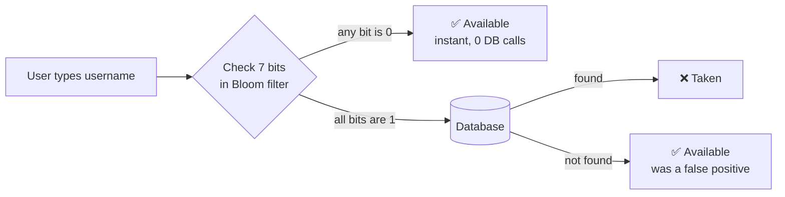

# 01 · Bloom Filter

> **Interview question:** "We have 10 crore users. A new user types a username on the sign-up page. How do you tell them *instantly* whether it's taken?"

---

## 🧠 The one-line answer

A **Bloom Filter** is a tiny, super-fast "maybe-list" that sits in front of your database.
It can say **"definitely NOT taken"** or **"maybe taken"**, and it is never wrong about the first one.

---

## 🍛 Real-life analogy

Think of a hostel warden with a register of 10 crore names. Searching that register every time someone asks is slow.

So instead he keeps a **wall of light switches**. Whenever a student joins, he flips a few specific switches ON (which switches depends on the name).
When someone asks "Is *rohan7* here?", he just looks at rohan7's switches:

- Any switch is **OFF**, so rohan7 never joined. **100% sure.**
- All switches are **ON**, so rohan7 *probably* joined, but other students might have turned those same switches on. Go check the register to be sure.

The wall of switches is the Bloom filter. The register is your database.

---

## ⚙️ How it works (step by step)

### Step 1: One very long row of bits
Start with a huge array of bits, all set to `0`.
For 10 crore users we'll use **m = 100 crore bits** (we'll see why below).

```
[0][0][0][0][0][0][0][0][0][0][0][0][0][0][0][0][0][0][0][0] ...
 0  1  2  3  4  5  6  7  8  9 10 11 12 13 14 15 16 17 18 19
```

### Step 2: A name becomes a position (hashing)
A **hash function** turns any username into a number, i.e. a position in the array.

```
h("vipul99") = 5   →  set bit[5] = 1
```

Same name always gives the same position. So when someone else checks `vipul99`, we look at `bit[5]`: it's `1`, so it's **taken**.

Notice what we stored: **not the name**, just one bit. That's why it's so small.

### Step 3: The problem is that two names can land on one position
```
h("amit42") = 5   ← collision!
```
`amit42` never signed up, but `bit[5]` is already `1` because of `vipul99`.
With just one hash function, we'd wrongly say "amit42 is taken". This is a **false positive**.

### Step 4: The fix is to use k hash functions (here k = 7)
Every name now sets **7 bits**, using 7 different hash functions `h1 … h7`.

```
vipul99  →  positions 2, 5, 7, 10, 13, 16, 18  → all set to 1
priya21  →  positions 0, 5, 9, 12, 13, 15, 17  → overlaps 2 of 7, that's fine
```

Overlaps happen. But for a *new* name, **all 7** of its bits being already ON is rare.

### Step 5: The rule (memorise this 👇)

| What you see in the 7 bits | Meaning |
|---|---|
| **Any one bit is 0** | ✅ **Definitely new**, 100% sure. Skip the database. |
| **All 7 bits are 1** | 🤔 **Maybe taken**, can't be sure. Ask the database. |

> A Bloom filter can give **false positives** ("maybe taken" when it's actually free)
> but **never false negatives** (it never says "free" for a taken name).

### Step 6: The full flow: filter first, database only if needed



- `neha07` → one bit is 0 → "available", **instantly**. DB calls: 0
- `rohan7` → all bits 1 → check DB → not found → available. DB calls: 1
- When a user actually signs up, save to DB **and** set their 7 bits in the filter.

Most new usernames get answered without touching the database at all. 🚀

---

## 📐 Sizing: how big, how many hashes?

Two standard formulas:

```
m = -n · ln(p) / (ln 2)²        ← array size (bits)
k = (m / n) · ln 2              ← number of hash functions
```

Where **n** = number of names, **p** = acceptable false-positive rate.

**Example:** n = 10 crore, p = 1 / 100 (1%)

| | Value |
|---|---|
| Bits per name (m/n) | 9.6 ≈ **10** |
| Array size (m) | ≈ **100 crore bits** |
| Hash functions (k) | 9.6 × 0.693 ≈ 6.6 → **7** |
| Memory | 10⁹ bits ÷ 8 = 125,000,000 bytes ≈ **120 MB** |

**That's all.** 10 crore usernames checked from ~120 MB of RAM. Storing the actual strings would take several GB.

---

## 🏭 In production: Redis does it for you

You don't have to build it yourself. **RedisBloom** (the `BF.*` commands) handles it:

```bash
> BF.RESERVE usernames 0.01 100000000   # 1% error, 10 crore capacity
OK
> BF.ADD usernames vipul99
(integer) 1
> BF.EXISTS usernames vipul99
(integer) 1     # maybe taken → confirm in DB
> BF.EXISTS usernames amit42
(integer) 0     # definitely available
```

---

## ⚖️ Trade-offs

| 👍 Pros | 👎 Cons |
|---|---|
| Tiny memory (~10 bits per item at 1% error) | False positives possible |
| O(k) lookup, basically instant | **Can't delete** items (unsetting a bit may break other names). Use a *Counting Bloom Filter* if you need deletes |
| Doesn't store the actual data | Must size it up front; overfilling raises the error rate |

---

## 🌍 Where it's used in the real world

- **Username / email availability checks** (this example)
- **Databases** like Cassandra, HBase and RocksDB skip reading disk files that definitely don't contain a key
- **Web browsers** have used them to check URLs against a malicious-site list
- **CDNs / caches** avoid caching "one-hit wonders"
- **Recommendation feeds** avoid showing you an article you've already seen

---

## 🎯 Interview one-liner

> "I'd put a Bloom filter in front of the users table. With 10 crore users at 1% false-positive rate, that's ~10 bits per user, so ~120 MB and 7 hash functions. If any bit is 0, the username is definitely free and we answer instantly. If all are 1, we confirm with the database. In production I'd use RedisBloom."

---

## 🧪 Try it yourself

Run the tiny Python demo: [`code/bloom_filter.py`](../code/bloom_filter.py)

```bash
python code/bloom_filter.py
```

---

<sub>📺 Inspired by this explainer reel (Hindi): https://www.instagram.com/reel/DeCnTJYTWGa/</sub>
