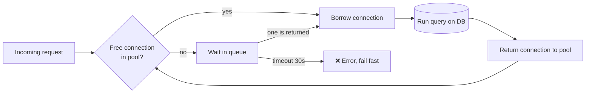

# 02 · Connection Pooling

> **Interview question:** "What is connection pooling? And how big should the pool be?"

---

## 🧠 The one-line answer

A **connection pool** opens a small, fixed set of database connections **once** and lets every request **borrow one and return it**, instead of opening a new connection per request.

---

## 🛺 Real-life analogy

Think of a railway station with **auto-rickshaws**.

- **No pool:** every passenger buys a brand-new auto, rides once, and scraps it. Slow and wasteful.
- **With a pool:** the station keeps **10 autos** waiting in a line. A passenger takes one, rides, and the auto comes back to the line for the next person.
- **All 10 busy?** The next passenger **waits in the queue** for a short time. They don't buy a new auto.

The autos are connections. The line is the pool.

---

## ⚙️ How it works (step by step)

### Step 1: A connection is not cheap
Before your app can run even one query, it has to:

```
🔗 TCP handshake  →  🔒 TLS handshake  →  🔑 Authenticate  →  📄 finally, the query
```

### Step 2: Open. Query. Close. (the naive way)
If every request opens a fresh connection:

```
connect  ██████████████████████████████  30 ms
query    ██                                2 ms
```

You spend **15× more time connecting** than doing the actual work.

### Step 3: Postgres runs one process per connection
Postgres starts a **separate OS process for every connection**. Each one eats RAM, so more connections means less memory for everything else.

### Step 4: The Diwali sale problem 🛒
The Diwali sale goes live and **1,000 requests** hit at once. Every request tries to open its own connection.

```
Postgres  max_connections = 100
requests  = 1,000
→ 100 connections opened, and 900 requests get "too many connections" errors 💥
```

### Step 5: The pool
At startup, the app server opens **10 connections** and keeps them alive.

```
app server              postgres (max 100)
 pool · 10
 [■] ───────────────── [■]
 [■] ───────────────── [■]
 ...    10 open, reused    ...      →  10 / 100 used
```

### Step 6: Borrow → return
1. A request **borrows** a free connection from the pool.
2. It runs the query (**2 ms**; no 30 ms connect).
3. It **returns** the connection to the pool for the next request.

### Step 7: All busy? Wait.
If all 10 are in use, new requests **wait in a queue**. A timeout (commonly **30 s**) makes them fail cleanly instead of waiting forever.

### Step 8: Never more than 10
Whether traffic is low or huge, the database **never sees more than 10 connections** from this server. The pool protects the database.



---

## 📐 Sizing: bigger pool = faster? No!

### "Let's make it as big as we want." ❌
Say the DB has **8 CPU cores** and you allow **500 connections**:

- **8 cores can truly run only 8 queries at a time.** The other 492 just wait while the CPU keeps **switching** between them (context switching).
- **RAM runs out.** 500 processes eat memory that Postgres would have used for its **cache**, so more reads go to disk.
- Result: throughput rises at first, then **drops**. More connections make the database **slower**.

```
throughput
   │        ╱╲
   │      ╱    ╲
   │    ╱        ╲  ← too many connections = slow
   │  ╱
   └──────────────────── connections
```

### The rule of thumb
```
pool size ≈ CPU cores × 2
```

**Example:** DB with 8 cores
```
8 × 2 = 16  →  round up to 20 connections total
```

That **20 is for the whole system**, not for each server. With **5 app servers**:
```
20 ÷ 5 = 4 connections per app server
```

### Then: load test ✅
The formula is a **starting point**. Run a load test, watch latency, and adjust.

---

## 🏭 In production

You almost never write a pool yourself. Every serious DB library has one.

**Python (SQLAlchemy)**
```python
engine = create_engine(
    "postgresql://user:pass@db/app",
    pool_size=4,        # 4 per app server (20 total / 5 servers)
    max_overflow=0,     # never go above the pool size
    pool_timeout=30,    # wait max 30s for a free connection
)
```

**Java (HikariCP, the Spring Boot default)**
```properties
spring.datasource.hikari.maximum-pool-size=4
spring.datasource.hikari.connection-timeout=30000
```

**PgBouncer**: a separate pooler that sits *in front of* Postgres, so thousands of app connections share a few real ones:
```ini
[pgbouncer]
pool_mode = transaction
max_client_conn = 1000     ; app side can open many
default_pool_size = 20     ; Postgres only ever sees 20
```

---

## ⚖️ Trade-offs

| 👍 Pros | 👎 Cons |
|---|---|
| No 30 ms connect cost per request | Pool too small → requests queue up |
| DB connections capped, so traffic spikes can't crash it | Pool too big → DB slows down (CPU switching, RAM) |
| Predictable memory use on the DB | Must be sized for the *whole fleet*, not per server |
| Fails fast with a timeout instead of piling up | Stale/broken connections need health checks |

---

## 🌍 Where it's used in the real world

- **Every web backend** talking to Postgres / MySQL (Django, Spring Boot, Node, Rails)
- **PgBouncer / RDS Proxy** in front of databases with many app servers or serverless functions
- **HTTP clients** keep a pool of keep-alive connections to other services
- **Redis clients** reuse a pool of connections the same way

---

## 🎯 Interview one-liner

> "Opening a DB connection costs ~30 ms of TCP, TLS and auth, and Postgres spawns a process per connection, so instead we keep a pool of connections open and borrow and return them. When the pool is busy, requests wait with a timeout, so the DB never sees more than the pool size. Bigger isn't better: start around cores × 2 for the whole system, say 20 for an 8-core DB, which is 4 each across 5 app servers, then tune with a load test."

---

## 🧪 Try it yourself

Run the demo: [`code/connection_pooling.py`](../code/connection_pooling.py). It simulates the Diwali sale with and without a pool.

```bash
python code/connection_pooling.py
```

---

<sub>📺 Inspired by an explainer reel (Hindi) on connection pooling.</sub>
