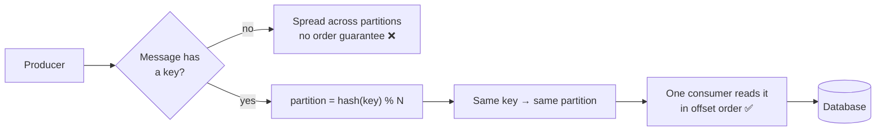

# 03 · Kafka Partitions & Message Ordering

> **Interview question:** "A user changed their email twice in 2 seconds, but the database saved the *old* one. We had Kafka in between. What went wrong?"

---

## 🧠 The one-line answer

Kafka keeps order **only inside a partition**, not across a whole topic. If related messages need to stay in order, send them with the **same key** so they all land in the **same partition**.

---

## 🧾 Real-life analogy

Think of a bank with **3 counters**, each with its own token queue.

- Inside one counter, tokens are served **strictly in order**: 100, 101, 102.
- Across counters there's **no order**. Counter 0 might be stuck with a slow customer while counter 1 finishes fast.
- If you give two forms for the *same account* to **two different counters**, the second form might get processed first. 😬
- Fix: a rule that **all forms for one account go to the same counter**, decided by the account number.

The counters are partitions. The account number is the key.

---

## ⚙️ How it works (step by step)

### Step 1: The bug
```
t = 0s   user sets email → chirkut@gmail.com
t = 2s   user sets email → chirkut007@gmail.com
DB final value          → chirkut@gmail.com   ❌ (old one won!)
```
Our mistake: we **assumed Kafka processes every message in order**.

### Step 2: What Kafka is
Kafka is a **middleman between services**.
- One service **writes** messages into it. That service is the **producer**.
- Another service **reads** them at its own speed and saves them to the DB. That service is the **consumer**.
- If the consumer goes down for a while, messages are **kept safe**. When it's back, it continues **from where it left off**.

A message is just data, e.g. "user-42 changed email to X".

### Step 3: Topics
Messages are grouped by type into **topics**:
```
orders        ● ● ●
payments      ● ● ●
user-update   ●        ← our email-change messages go here
```

### Step 4: Partitions and offsets
Each topic is split into **partitions**. Say `user-update` has 3:
```
topic: user-update
partition 0   [100][101][102] ...
partition 1   [100][101] ...
partition 2   [100][101][102] ...
               └── offset: each message's number inside its partition
```
A consumer reads a partition **in offset order**: 100 → 101 → 102.

### Step 5: Consumer groups
When load is high, run **multiple copies** of the consumer: X, Y, Z. Together they form a **consumer group**.

```
partition 0  →  X
partition 1  →  Y
partition 2  →  Z
```
**Rule:** inside a group, each partition is read by **only one** consumer. One partition is never split between two consumers.

Why? Order **inside** a partition is guaranteed. Order **between** partitions is not, because each partition is consumed at its own speed.

### Step 6: Replaying the bug
We sent both updates **without a key**:
```java
new ProducerRecord<>("user-update", null, email)   // key = null
```
With no key, the producer **spreads messages across partitions** to balance load:
```
chirkut@     → partition 0 → consumer X  (stuck in a slow query 🐢)
chirkut007@  → partition 1 → consumer Y  (saves instantly ⚡)
```
1. Y saves `chirkut007@` first ✅
2. X finally finishes and saves `chirkut@`, **overwriting the new email** ❌

### Step 7: The fix is to send a key
```java
new ProducerRecord<>("user-update", "user-42", email)   // key = user id
```
The producer picks the partition from the key:
```
partition = hash("user-42") % 3 = 1
```
**Every** message with key `user-42` goes to **partition 1**, and only **one consumer (Y)** reads it, in order:
```
partition 1:  [chirkut@] → [chirkut007@]   → DB = chirkut007@gmail.com ✅
```



---

## 📐 The numbers that matter

| Thing | Rule |
|---|---|
| Partition for a message | `hash(key) % number_of_partitions` |
| Max useful consumers in a group | = number of partitions (extra consumers sit idle) |
| Order guarantee | Per partition only, i.e. **per key** if you use keys |

⚠️ **Changing the partition count** changes `hash(key) % N`, so the same key can move to a new partition. Pick a partition count with room to grow.

---

## 🏭 In production

**Java**
```java
producer.send(new ProducerRecord<>("user-update", userId, email));
```

**Node.js (kafkajs)**
```js
await producer.send({
  topic: 'user-update',
  messages: [{ key: 'user-42', value: 'chirkut007@gmail.com' }],
});
```

**Create a topic with 3 partitions (CLI)**
```bash
kafka-topics.sh --create --topic user-update --partitions 3 --bootstrap-server localhost:9092
```

Kafka's default partitioner hashes the key with **murmur2**. The idea is the same as `hash % N`.

---

## ⚖️ Trade-offs

| 👍 Pros of keying | 👎 Cons |
|---|---|
| All events for one user/order stay in order | A "hot" key (one huge user) overloads one partition |
| Still scales: different keys spread across partitions | Adding partitions remaps keys and can break ordering briefly |
| Simple: just pick the right key (user id, order id) | Order is still **not global** across all keys |

---

## 🌍 Where it's used in the real world

- **User profile updates**: key = user id
- **Order lifecycle** (placed → paid → shipped): key = order id
- **Bank transactions per account**: key = account number
- **Chat messages per conversation**: key = chat id
- **Change Data Capture** (DB → Kafka): key = row's primary key

---

## 🎯 Interview one-liner

> "Kafka only guarantees order within a partition. We sent email updates without a key, so they went to different partitions, and a slow consumer saved the older email last. The fix is to use the user id as the message key: `hash(key) % partitions` sends every event for that user to the same partition, which is read by exactly one consumer in the group, in offset order."

---

## 🧪 Try it yourself

Run the demo: [`code/kafka-partitions.js`](../code/kafka-partitions.js). It replays the email bug with and without a key.

```bash
node code/kafka-partitions.js
```

---

<sub>📺 Inspired by an explainer reel (Hindi) on Kafka partitions and ordering.</sub>
