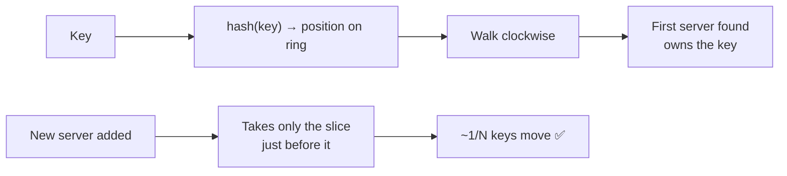

# 04 · Consistent Hashing

> **Interview question:** "You have 4 cache servers and use `hash(key) % 4` to pick one. Traffic grows and you add a 5th. What breaks, and how do you fix it?"

---

## 🧠 The one-line answer

**Consistent hashing** places servers and keys on a circle, so adding or removing a server only moves **~1/N of the keys** instead of almost all of them.

---

## 🏏 Real-life analogy

Think of a **circular park track** with 4 chai stalls placed around it.
Every walker buys chai from the **next stall clockwise** from where they are standing.

- A **5th stall opens**: only the walkers just before it switch over. Everyone else keeps their usual stall.
- With the **modulo way**, it's like renumbering every walker's stall from scratch. Almost everybody has to switch.

---

## ⚙️ How it works (step by step)

### Step 1: The simple way, modulo
```
server = hash(key) % N
hash("user-7") = 1234567   →  1234567 % 4 = 3  →  server-3
```
Works fine… until **N changes**.

### Step 2: The problem when you add a server
```
N = 4  →  N = 5
hash % 4  vs  hash % 5  give different answers for ~80% of keys
```
**80% of keys move** to a different server. For a cache that means 80% cache misses at once, and they all hit the database together. 💥 This is called a **cache stampede**.

### Step 3: Put everything on a ring
Imagine the hash space (0 → 2³²) bent into a **circle**.
- Hash each **server** name and place it on the ring.
- Hash each **key** and place it on the ring.
- A key belongs to the **first server clockwise** from it.

```
              S0
         ●          ●  key A → S1
      S3                S1
         ●          ●  key B → S2
              S2
```

### Step 4: Adding a server moves only its neighbours' keys
Add S4 between S1 and S2: only the keys in that one slice move from S2 to S4. **Everything else stays put.**



### Step 5: Virtual nodes for even load
With only 4 points on the ring, slices are uneven, so one server may get 40% of the keys.
Fix: place each server **many times** (e.g. 100 **virtual nodes**: `S0#1`, `S0#2`, …). The slices become small and even.

---

## 📐 The numbers

From the demo, with 1,00,000 keys and 4 → 5 servers:

| Method | Keys moved |
|---|---|
| `hash % N` | **80.1%** |
| Consistent hashing (100 vnodes) | **19.2%** (ideal is 1/5 = 20%) |

Load per server with 100 virtual nodes: roughly **17–23% each**. More virtual nodes give an even more balanced spread.

---

## 🏭 In production

You rarely build this yourself:
- **Cassandra / DynamoDB** place data on a token ring
- **Redis Cluster** uses 16,384 hash slots (a fixed-slot version of the same idea)
- **Nginx**: `hash $request_uri consistent;` for sticky upstream routing
- **Memcached clients** (ketama hashing)

---

## ⚖️ Trade-offs

| 👍 Pros | 👎 Cons |
|---|---|
| Adding/removing a server moves only ~1/N keys | More complex than `% N` |
| No mass cache misses during scaling | Needs virtual nodes for even load |
| Works well with many servers coming and going | Lookup is a binary search (O(log n)), not O(1) |

---

## 🌍 Where it's used in the real world

- **Distributed caches** (Memcached, Redis Cluster)
- **Distributed databases** (Cassandra, DynamoDB, Riak)
- **CDNs and load balancers** routing a URL to the same edge server
- **Chat / WebSocket servers**: the same user always goes to the same node

---

## 🎯 Interview one-liner

> "With `hash % N`, adding a 5th server remaps ~80% of keys and floods the DB with cache misses. Consistent hashing puts servers and keys on a ring, and each key goes to the next server clockwise, so a new server only takes ~1/N of the keys. Virtual nodes, around 100 per server, keep the load even."

---

## 🧪 Try it yourself

```bash
node code/consistent-hashing.js
```
[`code/consistent-hashing.js`](../code/consistent-hashing.js) compares keys moved under modulo and under the ring.
