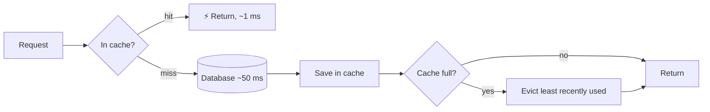

# 05 · Caching & LRU Eviction

> **Interview question:** "Your product page takes 50 ms to load from the database. How do you make it fast? And when the cache is full, what do you throw out?"

---

## 🧠 The one-line answer

A **cache** keeps hot data in fast memory so you skip the slow database. When it's full, **LRU (Least Recently Used)** removes the item nobody has touched for the longest time.

---

## 🧳 Real-life analogy

Your **study table** fits only 3 books. The rest are in the cupboard (the database).

- Need a book that's on the table? Grab it instantly. That's a **cache hit**.
- Not on the table? Walk to the cupboard. That's a **cache miss**, and it's slow.
- Table full? Put back the book you **haven't opened for the longest time**. That's **LRU**.

---

## ⚙️ How it works (step by step)

### Step 1: Cache-aside (the most common pattern)
```
1. App checks the cache
2. HIT  → return it (≈1 ms)
3. MISS → read from DB (≈50 ms), store in cache, return it
```



### Step 2: The cache fills up
Memory is limited, so you must pick something to **evict**. Common policies:

| Policy | Evicts | Good for |
|---|---|---|
| **LRU** | Least *recently* used | Most apps (default choice) |
| LFU | Least *frequently* used | Stable "always popular" items |
| FIFO | Oldest inserted | Simple, but ignores usage |
| TTL | Anything past its expiry time | Data that goes stale |

### Step 3: LRU in action (capacity = 3)
```
get iphone  MISS   [iphone]
get tv      MISS   [iphone, tv]
get shoes   MISS   [iphone, tv, shoes]
get iphone  HIT    [tv, shoes, iphone]      ← iphone moves to "most recent"
get laptop  MISS   evict tv → [shoes, iphone, laptop]
```
`tv` was evicted, not `iphone`, because iphone was used recently.

### Step 4: How LRU is O(1)
- A **hash map** gives instant lookup.
- A **doubly linked list** (or JS `Map`, which keeps insertion order) tracks recency.
- On every `get`, move the item to the "newest" end. To evict, remove from the "oldest" end.

---

## 📐 The numbers

From the demo (8 requests, capacity 3, DB = 50 ms, cache = 1 ms):
- 2 hits, 6 misses → **302 ms** vs **400 ms** without a cache.

Real systems have far higher hit rates (often 90%+), because a small share of items gets most of the traffic. At a 90% hit rate:
```
avg = 0.9 × 1 ms + 0.1 × 50 ms ≈ 6 ms   (vs 50 ms)
```

---

## 🏭 In production

**Redis as an LRU cache**
```bash
maxmemory 2gb
maxmemory-policy allkeys-lru
```

**Cache-aside in Node.js**
```js
let product = await redis.get(`product:${id}`);
if (!product) {
  product = await db.products.findById(id);
  await redis.set(`product:${id}`, JSON.stringify(product), 'EX', 300); // 5 min TTL
}
```

---

## ⚖️ Trade-offs

| 👍 Pros | 👎 Cons |
|---|---|
| 50 ms → ~1 ms for hot data | **Stale data**: cache and DB can disagree |
| Takes load off the database | Invalidation is hard ("when do I delete it?") |
| LRU is simple and O(1) | One big scan can flush out useful items |
| | Cold start: an empty cache means everything misses |

---

## 🌍 Where it's used in the real world

- **Redis / Memcached** in front of almost every web backend
- **CPU caches** (L1/L2/L3) use LRU-like policies
- **Browsers** cache images, CSS and JS
- **CDNs** cache content close to users
- **DB buffer pools** (Postgres, MySQL) keep hot pages in RAM

---

## 🎯 Interview one-liner

> "Put Redis in front of the DB with cache-aside: check the cache, and on a miss read the DB and store the result with a TTL. When memory is full, evict with LRU, using a hash map plus a doubly linked list for O(1) get and evict. The main risk is stale data, handled with TTLs or deleting the key on writes."

---

## 🧪 Try it yourself

```bash
node code/lru-cache.js
```
[`code/lru-cache.js`](../code/lru-cache.js) traces every hit, miss and eviction.
