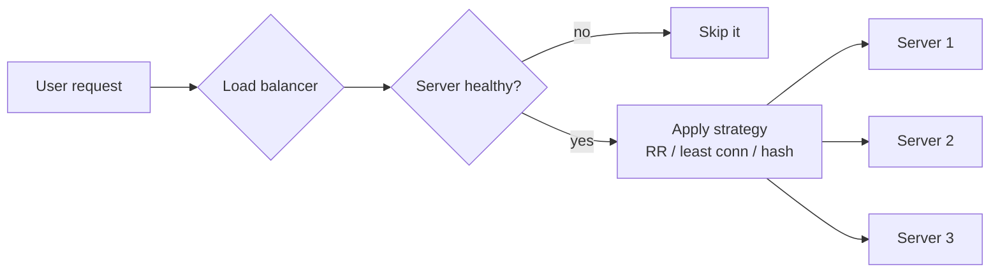

# 06 · Load Balancing

> **Interview question:** "One server can't handle your traffic, so you run 3. How do requests get split between them, and which strategy would you pick?"

---

## 🧠 The one-line answer

A **load balancer** sits in front of your servers and sends each request to a healthy one, using a strategy like **Round Robin** or **Least Connections**.

---

## 🛃 Real-life analogy

Think of an **airport security check** with 3 counters and one staff member directing people.

- **Round Robin:** "You go to 1, you to 2, you to 3, you to 1…" Fair, but blind. If counter 1 has a family with 10 bags, people still get sent there.
- **Least Connections:** "Go to whichever counter has the shortest line." Smarter.
- **Health check:** if a counter closes, the staff stops sending people there.

---

## ⚙️ How it works (step by step)

### Step 1: The load balancer is the single front door
```
                ┌──► Server 1
users ──► LB ───┼──► Server 2
                └──► Server 3
```
Users see one address. The LB spreads requests across the servers behind it.

### Step 2: Pick a strategy

| Strategy | How it picks | Best when |
|---|---|---|
| **Round Robin** | 1 → 2 → 3 → 1 … | Requests are similar in cost |
| **Weighted Round Robin** | Bigger servers get more turns | Servers have different sizes |
| **Least Connections** | Fewest open requests right now | Requests vary a lot in duration |
| **IP / Consistent Hash** | Same user → same server | Sticky sessions, caches |

### Step 3: Health checks
The LB pings each server (e.g. `GET /health` every 5 s). After a few failed checks, the server is **taken out**. When it recovers, it's added back.



### Step 4: Layer 4 vs Layer 7
- **L4 (TCP):** looks only at IP and port. Very fast, no idea what the request is.
- **L7 (HTTP):** reads URL and headers, so it can route `/api/*` and `/images/*` to different servers.

---

## 📐 The numbers

From the demo: 3 servers, a request every 10 ms, and **every 3rd request is a heavy 600 ms report**:

| Strategy | Peak open connections (S0 / S1 / S2) |
|---|---|
| Round Robin | **20 / 1 / 1** 😵 |
| Least Connections | **8 / 7 / 7** ✅ |

Round Robin's pattern lined up with the traffic pattern, so **every heavy request landed on S0**. Least Connections looked at actual load and spread them out.

---

## 🏭 In production

**Nginx**
```nginx
upstream app {
    least_conn;              # remove this line for round robin
    server 10.0.0.1;
    server 10.0.0.2;
    server 10.0.0.3;
}
server {
    location / { proxy_pass http://app; }
}
```

Managed options: **AWS ALB / NLB**, **GCP Load Balancing**, **HAProxy**, **Kubernetes Services / Ingress**.

---

## ⚖️ Trade-offs

| 👍 Pros | 👎 Cons |
|---|---|
| Scale out by just adding servers | The LB itself can fail (run 2+ LBs) |
| Bad servers are removed automatically | Sticky sessions make scaling harder |
| Zero-downtime deploys (drain one server at a time) | Least Connections needs live tracking |
| One public address | Adds one extra network hop |

---

## 🌍 Where it's used in the real world

- **Every large website**: Swiggy, Flipkart, IRCTC sit behind load balancers
- **Kubernetes** spreads traffic across pods
- **DNS load balancing** across regions
- **Databases**: read replicas behind a proxy

---

## 🎯 Interview one-liner

> "Put an L7 load balancer in front of the servers, with health checks so dead ones are removed. Round Robin is fine when requests cost about the same. When durations vary a lot, use Least Connections, because Round Robin can pile all the heavy requests onto one server. Use consistent hashing if a user must stick to one server, and run two LBs so the LB isn't a single point of failure."

---

## 🧪 Try it yourself

```bash
node code/load-balancing.js
```
[`code/load-balancing.js`](../code/load-balancing.js) compares Round Robin and Least Connections with mixed request sizes.
