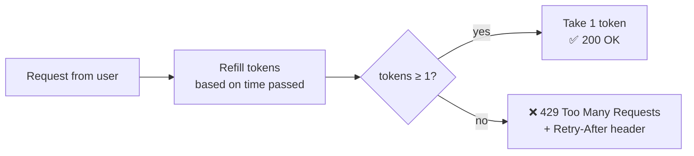

# 07 · Rate Limiting

> **Interview question:** "Someone is hitting your 'Send OTP' API 100 times a second. How do you stop them without blocking normal users?"

---

## 🧠 The one-line answer

A **rate limiter** caps how many requests a user (or IP, or API key) can make in a time window. Extra requests get **`429 Too Many Requests`**.

---

## 🍬 Real-life analogy

A **bowl of 5 toffees** at the reception desk, refilled with **1 toffee every second**.

- Each visitor takes 1 toffee per request.
- A burst of 5 people? Fine, the bowl had 5.
- The 6th person right after? Bowl empty, so **come back later** (429).
- Wait a few seconds and toffees are back.

This is the **Token Bucket** algorithm.

---

## ⚙️ How it works (step by step)

### Step 1: Identify who is calling
Rate limit **per something**: user id, API key, or IP address.

### Step 2: Pick an algorithm

| Algorithm | Idea | Note |
|---|---|---|
| **Token Bucket** | Bucket of N tokens, refills at a fixed rate | Allows short bursts. Most popular |
| Leaky Bucket | Requests drain out at a fixed rate | Smooth output, no bursts |
| Fixed Window | Max N per minute (counter resets at :00) | Simple, but allows 2N at the window edge |
| Sliding Window | Counts the last 60 s from *now* | Fixes the edge problem, a bit more work |

**The fixed-window edge problem:** limit 5/min, 5 requests at 0:59 and 5 more at 1:00 means 10 in 2 seconds.

### Step 3: Token bucket logic
```
on each request:
  tokens = min(capacity, tokens + elapsed × refillRate)
  if tokens ≥ 1 → tokens -= 1, allow (200)
  else          → reject (429)
```



### Step 4: Where to store the counters
With many app servers, counters must be **shared**, usually in **Redis** (fast, atomic `INCR`, keys can auto-expire).

---

## 📐 The numbers

From the demo (bucket = 5 tokens, refill 1/sec):
```
t=0s    8 requests  → first 5 OK, next 3 rejected (429)
t=1s    1 request   → OK (1 token refilled)
t=2.5s  1 request   → 429 (only 0.5 token so far)
t=10s   3 requests  → all OK (bucket refilled to full)
```
Bursts up to 5 are allowed, and the long-term average is capped at 1 req/sec.

---

## 🏭 In production

**Nginx**
```nginx
limit_req_zone $binary_remote_addr zone=otp:10m rate=1r/s;
location /send-otp {
    limit_req zone=otp burst=5 nodelay;
}
```

**Express (Node.js)**
```js
const rateLimit = require('express-rate-limit');
app.use('/send-otp', rateLimit({ windowMs: 60_000, max: 5 }));
```

**Redis fixed window (simple)**
```
INCR  rate:user42:202610291530
EXPIRE rate:user42:202610291530 60
→ if value > 5, return 429
```

Also built into **API gateways** (AWS API Gateway, Kong, Cloudflare).

---

## ⚖️ Trade-offs

| 👍 Pros | 👎 Cons |
|---|---|
| Stops abuse, brute force, OTP / SMS cost spikes | Wrong limits block real users |
| Protects servers from traffic spikes | Shared counters (Redis) add a network call |
| Fair usage across customers | IP-based limits hit people sharing one IP (offices, mobile networks) |
| Token bucket allows natural bursts | Distributed limits are only approximately exact |

---

## 🌍 Where it's used in the real world

- **OTP / login endpoints**: stop brute force and SMS-bill attacks
- **Public APIs** (GitHub: 5,000 requests/hour per token)
- **Payment and booking flows**: Tatkal-style rush protection
- **Scrapers and bots**: per-IP limits

---

## 🎯 Interview one-liner

> "I'd use a token bucket per user or IP, stored in Redis so all app servers share it, say 5 tokens refilling at 1 per second. That allows small bursts but caps the average rate, and extra requests get 429 with a Retry-After header. I'd put it at the API gateway or Nginx so abusive traffic never reaches the app."

---

## 🧪 Try it yourself

```bash
node code/rate-limiter.js
```
[`code/rate-limiter.js`](../code/rate-limiter.js) simulates a user spamming the OTP endpoint.
