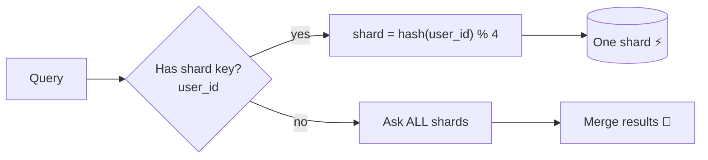

# 08 · Database Sharding

> **Interview question:** "Your orders table has 50 crore rows and one database can't keep up. How do you split it?"

---

## 🧠 The one-line answer

**Sharding** splits one big table across several databases (**shards**), each holding a slice of the rows. A **shard key** decides which row lives where.

---

## 🏫 Real-life analogy

A school with 5,000 students and **one** office clerk is always a long queue.

So the school opens **4 counters**:
- **By roll number (hash):** each counter gets a mix of students, so the load is even.
- **By class (range):** Class 1–3 at counter 0, 4–6 at counter 1… Easy, but on result day for Class 10, **one counter is flooded** while the others sit idle.

The counters are shards. "Roll number" or "class" is the shard key.

---

## ⚙️ How it works (step by step)

### Step 1: First try scaling up (vertical)
Bigger CPU, more RAM, faster disk. Simple, but there's a **ceiling** and it gets expensive.

### Step 2: Read replicas
If the problem is **reads**, add replicas that copy the data. But **writes** still go to one machine, and the data still has to fit on one disk.

### Step 3: Shard (horizontal scaling)
Split the **rows** across machines:
```
orders table (50 crore rows)
   ├── shard 0 → ~12.5 crore rows
   ├── shard 1 → ~12.5 crore rows
   ├── shard 2 → ~12.5 crore rows
   └── shard 3 → ~12.5 crore rows
```
Every shard has the **same schema** but **different rows**.

### Step 4: Pick a sharding strategy

| Strategy | Rule | Good | Bad |
|---|---|---|---|
| **Range** | `month 1–3 → S0, 4–6 → S1 …` | Range queries are easy | **Hot shard**: new data all hits one shard |
| **Hash** | `hash(user_id) % 4` | Even spread | Range queries hit all shards |
| **Directory** | Lookup table: `user → shard` | Fully flexible | The lookup table is an extra dependency |

### Step 5: Route every query
The app (or a proxy) computes the shard from the key:
```
shard = hash(user_id) % 4
```



### Step 6: Choose the shard key carefully
A good shard key:
- Has **many distinct values** (user_id ✅, country ❌)
- Spreads **writes evenly** (not created_at ❌)
- Matches your **most common query** ("my orders" → user_id ✅)

---

## 📐 The numbers

From the demo: **10,000 new orders today** across 4 shards:

| Strategy | S0 | S1 | S2 | S3 |
|---|---|---|---|---|
| Range by month | 0% | 0% | 0% | **100%** 🔥 |
| Hash by user_id | 25% | 25% | 24% | 25% ✅ |

Range sharding by date sends every new write to the **latest shard**. Hashing the user id spreads them evenly.

Query cost with `hash(user_id)`:
- "Orders of user 42" → **1 shard**
- "All orders above ₹10,000" → **all 4 shards** (scatter-gather)

---

## 🏭 In production

- **MongoDB**: built-in sharding: `sh.shardCollection("shop.orders", { userId: "hashed" })`
- **Vitess** (MySQL, used by YouTube and Slack)
- **Citus** (Postgres): `SELECT create_distributed_table('orders', 'user_id');`
- **Cassandra / DynamoDB**: the partition key *is* the shard key, sharding by default

---

## ⚖️ Trade-offs

| 👍 Pros | 👎 Cons |
|---|---|
| Writes and storage scale almost without limit | **Cross-shard joins** are slow or impossible |
| Each shard is smaller, so indexes stay fast | **Transactions across shards** are hard |
| One shard failing affects only part of the users | **Resharding** (4 → 8) means moving data (consistent hashing helps, see Day 04) |
| | Wrong shard key = hot shard, very painful to fix |

**Rule:** shard **last**. Try indexes, caching (Day 05), and read replicas first.

---

## 🌍 Where it's used in the real world

- **Instagram**: Postgres sharded by user id
- **Discord**: messages in Cassandra/ScyllaDB, keyed by channel + time bucket
- **Uber, Flipkart**: order and trip data split by city or user
- **YouTube**: MySQL sharded with Vitess

---

## 🎯 Interview one-liner

> "First I'd try indexes, caching and read replicas. If writes or storage still outgrow one machine, I'd shard the orders table by `hash(user_id)`. That spreads writes evenly and keeps 'my orders' on a single shard. Range sharding by date would make the newest shard hot. The costs are cross-shard joins and transactions, and resharding, which consistent hashing makes cheaper."

---

## 🧪 Try it yourself

```bash
node code/sharding.js
```
[`code/sharding.js`](../code/sharding.js) compares range and hash sharding for today's writes.
