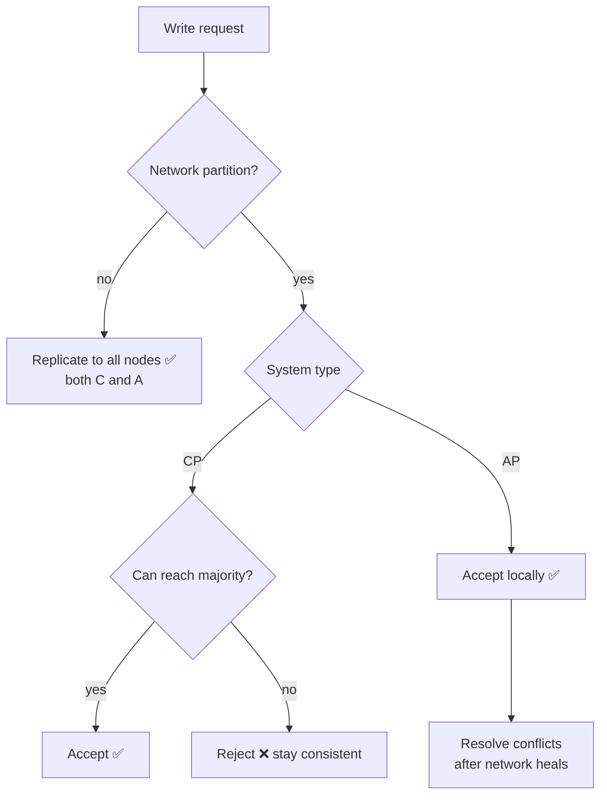

# 09 · CAP Theorem

> **Interview question:** "Your database runs in Mumbai and Delhi. The network link between them breaks. Do you keep accepting writes, or stop?"

---

## 🧠 The one-line answer

When the network splits (a **Partition**), a distributed system must choose: stay **Consistent** (refuse requests it can't confirm) or stay **Available** (answer anyway, possibly with stale or conflicting data).

---

## 🚆 Real-life analogy

**1 seat left** on a train. Two booking counters, one in Mumbai and one in Delhi, normally phone each other before every booking.

The **phone line goes dead**. Two passengers walk up at the same time, one at each counter.

- **Consistent choice:** "Sorry, can't confirm right now, try again." No one gets the seat, but **no double booking**.
- **Available choice:** both counters say "Booked! ✅". Both passengers are happy… until they meet at the same seat. 😬

You can't have **both** while the line is dead. That's CAP.

---

## ⚙️ How it works (step by step)

### Step 1: The three letters

| Letter | Means |
|---|---|
| **C**onsistency | Every read sees the **latest write**. All nodes agree. |
| **A**vailability | Every request gets a **non-error response**. |
| **P**artition tolerance | The system keeps working even when nodes **can't talk** to each other. |

### Step 2: P is not optional
In any system spread across machines, networks **will** fail: cables, switches, cloud zones. So you **must** handle partitions.

That means the real choice is only made **during a partition**:
```
Partition happens →  choose C  (CP: reject / wait)
                  or choose A  (AP: answer, fix conflicts later)
```
"Pick 2 of 3" is a bit misleading. It's really **"when P happens, pick C or A."**

### Step 3: CP, consistent but may refuse
- Each write must be confirmed by a **majority (quorum)** of nodes.
- A node that can't reach the majority **rejects** the request.
- ✅ Never wrong data. ❌ Some users see errors during the outage.

### Step 4: AP, always answers but may be stale
- Every node accepts reads and writes on its own.
- When the network heals, nodes **sync up** and **resolve conflicts** (last-write-wins, merging, or app logic).
- ✅ Always up. ❌ Temporary stale reads or conflicts (like the double booking).



### Step 5: Choose per feature, not per company
The **same app** can make different choices:

| Feature | Choice | Why |
|---|---|---|
| Payments, bank balance, last train seat | **CP** | Wrong data costs money |
| Likes count, view count, feeds | **AP** | Slightly stale is fine, downtime is not |
| Shopping cart | **AP** | Merge carts later; never block "Add to cart" |
| Inventory at checkout | **CP** | Don't sell stock you don't have |

---

## 📐 The numbers

From the demo, **1 seat left**, with the link between Mumbai and Delhi broken:

| System | Rahul (Mumbai) | Priya (Delhi) | Result |
|---|---|---|---|
| **CP** | ❌ try again | ❌ try again | 0 bookings, **no overbooking**, but unavailable |
| **AP** | ✅ booked | ✅ booked | **2 bookings for 1 seat** ⚠️ needs fixing later |

**Quorum math (CP):** with **N = 3** replicas, a write needs **2** acks. One node can be cut off and the other two keep working. That's why CP clusters use **odd numbers** (3, 5). With only 2 nodes, a split leaves *neither* side with a majority, which is exactly what the demo shows.

---

## 🏭 In production

| Database | Leans | Notes |
|---|---|---|
| **Zookeeper, etcd** | CP | Majority quorum (Raft / ZAB) |
| **MongoDB** (default) | CP | Only the primary takes writes; minority side can't |
| **HBase, Spanner** | CP | Strong consistency |
| **Cassandra, DynamoDB** | AP | Tunable: `QUORUM` reads+writes push it toward C |
| **CouchDB, Riak** | AP | Conflict resolution on sync |

**Cassandra: tune per query**
```sql
CONSISTENCY QUORUM;   -- safer, closer to CP
CONSISTENCY ONE;      -- faster, more available, AP-like
```

---

## ⚖️ Trade-offs

| CP 👍 / 👎 | AP 👍 / 👎 |
|---|---|
| 👍 Data is always correct | 👍 Always responds, low latency |
| 👍 Simple to reason about | 👍 Survives outages gracefully |
| 👎 Errors / timeouts during partitions | 👎 Stale reads, conflicts to resolve |
| 👎 Writes wait for a quorum (slower) | 👎 App must handle "eventually consistent" data |

**Bonus (PACELC):** even with **no** partition, there's a trade-off between **Latency** and **Consistency**: waiting for replicas to confirm makes every write slower.

---

## 🌍 Where it's used in the real world

- **Banking / UPI ledgers**: CP. Never show a wrong balance.
- **IRCTC Tatkal last seat**: CP at booking time.
- **Instagram likes / YouTube views**: AP. Counts catch up later.
- **Amazon shopping cart** (the original Dynamo paper): AP, carts merged after conflicts.
- **DNS**: AP. Old records are served until updates spread.

---

## 🎯 Interview one-liner

> "Partitions will happen, so the real choice is what to give up during one: consistency or availability. For money and inventory I'd choose CP with majority quorums on 3 or 5 nodes, so the minority side rejects writes. For likes, feeds and carts I'd choose AP, accept writes everywhere and reconcile later. Cassandra lets you tune this per query with consistency levels like QUORUM or ONE."

---

## 🧪 Try it yourself

```bash
node code/cap-theorem.js
```
[`code/cap-theorem.js`](../code/cap-theorem.js) breaks the link between two replicas and books the last seat in CP and AP mode.
