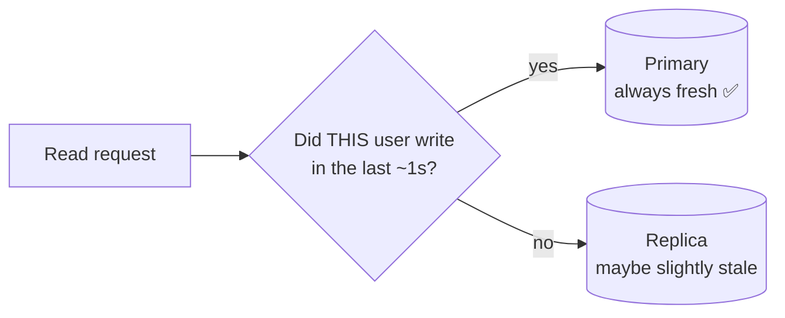

# 10 · Database Replication

> **Interview question:** "A user updates their bio, refreshes the page, and sees the *old* bio. The write succeeded. What's going on?"

---

## 🧠 The one-line answer

**Replication** keeps copies of the database on several machines: one **primary** takes writes and **replicas** copy them to serve reads. Copies can **lag** behind, so a read from a replica right after a write may return old data.

---

## 📒 Real-life analogy

A teacher (**primary**) writes notes on the board. Three students (**replicas**) copy them into notebooks, and classmates ask the *students* for notes.

- The teacher just wrote a new line. A student is still copying it.
- You ask that student right now and **get the old notes**. Wait a moment and they have it.
- Fix: if **you** just asked the teacher to add something, check with the **teacher**, not a student.

---

## ⚙️ How it works (step by step)

### Step 1: Why replicate?
- **Scale reads:** most apps read far more than they write, so spread reads over replicas.
- **Survive failures:** if the primary dies, promote a replica (**failover**).
- **Be closer to users:** a replica in Mumbai, another in Singapore.

### Step 2: Primary–replica (leader–follower)
```
            writes
  app  ───────────────►  PRIMARY
   │                       │  copies changes (replication log)
   │ reads                 ├──────► REPLICA 1
   └──────────────────────►├──────► REPLICA 2
```

### Step 3: Sync vs async

| Mode | Primary says "done" when… | 👍 | 👎 |
|---|---|---|---|
| **Synchronous** | replicas *also* confirm | No data loss, replicas always fresh | Slower writes. A slow replica blocks everything |
| **Asynchronous** | only the primary has saved it | Fast writes | **Replication lag**, and recent writes can be lost if the primary dies |
| **Semi-sync** | at least 1 replica confirms | Balance of both | Still a bit slower |

Most setups use **async** (or semi-sync), so **lag is normal**: usually milliseconds, sometimes seconds under load.

### Step 4: The bug, replication lag
```
t=0      UPDATE bio on primary ✅
t=0+1ms  SELECT bio from replica → old value ❌ (copy not there yet)
t=200ms  replica catches up      → new value ✅
```

### Step 5: Fix with read-your-writes consistency
- After a user **writes**, send **their** reads to the **primary** for a short time (e.g. 1 s), or until the replica has caught up.
- Everyone else keeps reading from replicas. A moment of staleness is fine for them.



Other fixes: track the write's log position and only read from a replica that has reached it, or use **sync** replication for critical data.

### Step 6: Failover
Primary dies → a replica is **promoted** to be the new primary. With async replication, the last few writes that weren't copied yet can be **lost**. That's the price of fast writes.

---

## 📐 The numbers

From the demo (async, lag ≈ 200 ms):

| Who reads | Right after the write | After 250 ms |
|---|---|---|
| Always-replica | ❌ old bio | ✅ new bio |
| Read-your-writes (same user) | ✅ new bio (from primary) | ✅ |
| Another user | old bio (fine for a moment) | ✅ |

**Read scaling:** if 1 primary handles ~5,000 reads/sec, then 1 primary + 4 replicas handles about **25,000 reads/sec**. Writes **don't** scale this way, because they all still go to the primary (that's what sharding solves, see Day 08).

---

## 🏭 In production

**Postgres streaming replication**
```sql
-- on the replica, check how far behind it is
SELECT now() - pg_last_xact_replay_timestamp() AS replication_lag;
```

**MySQL**
```sql
SHOW REPLICA STATUS\G   -- look at Seconds_Behind_Source
```

**Managed:** AWS RDS / Aurora read replicas, Google Cloud SQL replicas, MongoDB replica sets (`readPreference: "secondary"`).

**Routing reads in the app (Prisma example)**
```js
// writes → primary, reads → replicas (via @prisma/extension-read-replicas)
await prisma.$primary().user.findUnique({ where: { id } }); // force fresh read
```

---

## ⚖️ Trade-offs

| 👍 Pros | 👎 Cons |
|---|---|
| Scale reads by adding replicas | **Replication lag**: stale reads |
| High availability with failover | Writes still bottleneck on one primary |
| Backups and analytics run on a replica | Async can lose recent writes on failover |
| Replicas near users means lower latency | Two primaries (multi-leader) need conflict resolution |

---

## 🌍 Where it's used in the real world

- **Almost every production database**: 1 primary + read replicas
- **E-commerce product pages**: reads from replicas, orders written to the primary
- **Reporting / analytics** queries on a replica so they don't slow down the app
- **Multi-region apps**: a replica per region for fast local reads

---

## 🎯 Interview one-liner

> "The write went to the primary, but the read hit an async replica that hadn't caught up yet: replication lag. I'd add read-your-writes consistency: for a second after a user writes, route their reads to the primary, while everyone else keeps reading from replicas. Replicas scale reads and give failover, but writes still go through one primary, and async replication can lose the last few writes if the primary dies."

---

## 🧪 Try it yourself

```bash
node code/replication.js
```
[`code/replication.js`](../code/replication.js) shows a stale read caused by lag, and the read-your-writes fix.
