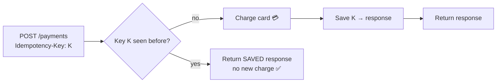

# 11 · Idempotency

> **Interview question:** "A user taps 'Pay ₹500'. The network times out, so the app retries. How do you make sure they're charged only once?"

---

## 🧠 The one-line answer

An operation is **idempotent** if doing it **once or many times has the same effect**. For payments, the client sends a unique **idempotency key**. The server remembers it and **returns the saved result** for any retry instead of charging again.

---

## 🛗 Real-life analogy

Pressing a **lift button** 5 times doesn't call 5 lifts. The first press registers the request, and the extra presses change nothing. That's idempotent.

A **vending machine** that drops a samosa every time you press is *not* idempotent. Press twice, pay twice.

Payments must behave like the lift button.

---

## ⚙️ How it works (step by step)

### Step 1: Why retries are dangerous
```
App ──"Pay ₹500"──► Server   ✅ charged
App ◄── response ── Server   ❌ lost (timeout / network drop)
App: "No answer… retry!" ──► Server   ✅ charged AGAIN 💸
```
The client **can't tell** "the request failed" from "the request worked but the answer got lost". So it retries, and without protection that means a double charge.

### Step 2: Which HTTP methods are already idempotent?

| Method | Idempotent? | Why |
|---|---|---|
| `GET` | ✅ | Just reads |
| `PUT /users/42 {bio}` | ✅ | Sets the same value again |
| `DELETE /orders/7` | ✅ | Already deleted means still deleted |
| `POST /payments` | ❌ | Each call creates a **new** payment |

`POST` is the one that needs help.

### Step 3: Add an idempotency key
1. Client generates a **unique key** (a UUID) **once per user action**, not once per retry.
2. Client sends it with every attempt: `Idempotency-Key: 9f1c…`
3. Server checks its store:
   - **New key** → process the payment, **save key + response**
   - **Seen key** → **return the saved response**, don't charge again



### Step 4: Handle the tricky cases
- **Two retries at the same moment:** use a DB **unique constraint** on the key (or a lock) so only one wins.
- **Same key, different body** (₹500 vs ₹600): reject with an error. It's a client bug.
- **How long to keep keys:** usually ~24 hours, then expire them (Redis TTL).

### Step 5: It's not just payments
Kafka consumers can receive the **same message twice** (at-least-once delivery, see Day 03). Make consumers idempotent too: store processed message ids, or use upserts (`INSERT … ON CONFLICT DO NOTHING`).

---

## 📐 The numbers

From the demo: a ₹500 payment where the client tries **3 times** because responses get lost:

| Setup | Charges created | Customer pays |
|---|---|---|
| No key | ch_1, ch_2, ch_3 | **₹1,500** ❌ |
| Idempotency-Key | ch_1 (then replayed twice) | **₹500** ✅ |

---

## 🏭 In production

**Stripe (real API)**
```bash
curl https://api.stripe.com/v1/payment_intents \
  -u sk_test_xxx: \
  -H "Idempotency-Key: 9f1c2e4a-…" \
  -d amount=50000 -d currency=inr
```

**Server side with Postgres**
```sql
CREATE TABLE idempotency_keys (
  key        TEXT PRIMARY KEY,      -- unique: the second insert fails
  response   JSONB,
  created_at TIMESTAMPTZ DEFAULT now()
);
```

**Server side with Redis (Node.js)**
```js
const saved = await redis.get(`idem:${key}`);
if (saved) return res.json(JSON.parse(saved));
const ok = await redis.set(`idem:${key}`, 'processing', 'NX', 'EX', 86400); // claim the key
if (!ok) return res.status(409).send('Request in progress');
const result = await chargeCard(req.body);
await redis.set(`idem:${key}`, JSON.stringify(result), 'EX', 86400);
res.json(result);
```

Also used by: **Razorpay**, **PayPal** and **AWS** APIs (client tokens).

---

## ⚖️ Trade-offs

| 👍 Pros | 👎 Cons |
|---|---|
| Safe retries, so no double charges or duplicate orders | Extra storage + lookup on every request |
| Clients can retry freely on timeouts | Must handle concurrent duplicates (locks / unique keys) |
| Same response every time, which makes debugging easy | Keys expire, so a very late retry isn't protected |
| Works with at-least-once queues | Client must generate the key per *action*, not per retry |

---

## 🌍 Where it's used in the real world

- **Payment APIs**: Stripe, Razorpay, PayPal
- **UPI** transactions carry a unique transaction reference id
- **Order placement**: "Place order" tapped twice still creates one order
- **Kafka / SQS consumers**: process each message id once
- **Webhooks**: providers retry, so receivers dedupe by event id

---

## 🎯 Interview one-liner

> "The client can't tell a failed request from a lost response, so it retries, and a plain POST would charge twice. I'd make the endpoint idempotent: the client generates a UUID once per payment and sends it as an Idempotency-Key on every retry. The server stores key → response with a unique constraint and a TTL of about 24 h, and returns the saved response for any repeat. I'd use the same idea for at-least-once Kafka consumers."

---

## 🧪 Try it yourself

```bash
node code/idempotency.js
```
[`code/idempotency.js`](../code/idempotency.js) retries a payment 3 times, first without and then with an idempotency key.
