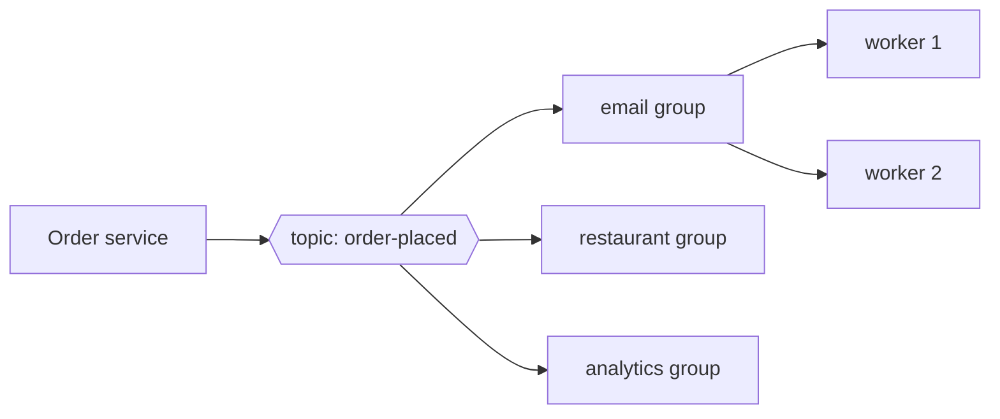

# 12 · Message Queues vs Pub/Sub

> **Interview question:** "When an order is placed, we need to send an email, tell the restaurant, and update analytics. And separately, generate invoice PDFs, which is slow. Queue or pub/sub? What's the difference?"

---

## 🧠 The one-line answer

- **Message queue:** each message is handled by **exactly one** worker. Use it to **share work**.
- **Pub/Sub:** each message is delivered to **every** subscriber. Use it to **broadcast an event**.

---

## 🍽️ Real-life analogy

**Message queue = restaurant kitchen order slips.**
Orders go on one rail. **Any free cook** grabs the next slip. Each dish is cooked **once**. More cooks means faster service.

**Pub/Sub = a WhatsApp group announcement.**
"Order #42 placed!" is posted once, and **everyone in the group** gets it. The delivery guy, the cashier and the manager each react in their own way. Add a new member and they start getting messages, and the sender doesn't change anything.

---

## ⚙️ How it works (step by step)

### Step 1: Why not call services directly?
```
Order service ──► email      (slow? down?)
              ──► restaurant
              ──► analytics
```
If the email service is slow, **placing an order becomes slow**. If it's down, the **order fails**. Plus the order service has to know about every other service.

Put a **broker** in the middle: the order service drops a message and returns immediately. ⚡

### Step 2: Message queue (point-to-point)
```
producer ──► [ job9 | job8 | ... | job1 ] ──► worker-A  (gets job1)
                                          ──► worker-B  (gets job2)
                                          ──► worker-C  (gets job3)
```
- Each message goes to **one** consumer, which then **acknowledges** (acks) it and it's removed.
- Worker crashes before acking? The message goes back and **another worker retries it**.
- Too slow? **Add workers.**

Use it for **background jobs**: invoice PDFs, image resizing, sending SMS.

### Step 3: Pub/Sub (fan-out)
```
                         ┌──► email-service       (own copy)
publisher ──► topic ─────┼──► restaurant-service  (own copy)
              "order-     └──► analytics-service   (own copy)
              placed"
```
- The publisher **doesn't know** who's listening.
- Each subscriber gets **its own copy** and processes at its own speed.
- New feature? **Subscribe a new service**. Zero changes to the publisher.

Use it for **events**: "order placed", "user signed up", "payment failed".

### Step 4: Combine them
Real systems often do **both**: a topic fans out to each service, and **inside** each service, several workers share that service's copy like a queue.

That's exactly **Kafka consumer groups** (Day 03):
- **Different groups** each get every message → pub/sub
- **Consumers within one group** split the partitions → queue



---

## 📐 The numbers

From the demo:

| Pattern | Input | What happened |
|---|---|---|
| Queue `send-invoice-pdf` | 9 jobs, 3 workers | 3 jobs each, **every job done once** |
| Pub/Sub `order-placed` | 1 event, 3 subscribers | **3 copies**, one per service |
| Add `loyalty-service` | next event | 4 copies, **publisher code unchanged** |

---

## 🏭 In production

| Tool | Style |
|---|---|
| **RabbitMQ** | Queues (plus exchanges for pub/sub fan-out) |
| **AWS SQS** | Queue |
| **AWS SNS** | Pub/Sub (often SNS → many SQS queues) |
| **Google Pub/Sub** | Pub/Sub with per-subscription queues |
| **Kafka** | Log-based: both, via consumer groups; also keeps messages for replay |
| **Redis** | `LPUSH`/`BRPOP` lists as a simple queue, `PUBLISH`/`SUBSCRIBE` for fire-and-forget pub/sub |

**Redis quick taste**
```bash
# queue
LPUSH invoices order-42
BRPOP invoices 0          # one worker gets it

# pub/sub
SUBSCRIBE order-placed    # in many terminals
PUBLISH order-placed '{"id":42}'   # all of them receive it
```

---

## ⚖️ Trade-offs

| | Message Queue | Pub/Sub |
|---|---|---|
| Who gets a message | **One** consumer | **All** subscribers |
| Main use | Share heavy work | Broadcast events |
| Scaling | Add more workers | Add more subscribers |
| Coupling | Producer knows the job type | Publisher knows **nothing** about subscribers |
| Watch out for | Poison messages that fail forever (use a **dead-letter queue**) | A slow subscriber falling behind. Duplicates, so make consumers **idempotent** (Day 11) |

Both add **eventual consistency**: the email arrives a moment *after* the order is saved, not at the same instant.

---

## 🌍 Where it's used in the real world

- **Swiggy / Zomato**: "order placed" event fans out to restaurant, delivery, notifications, analytics
- **Background jobs**: video encoding at YouTube, invoice PDFs, bulk SMS
- **Uber**: trip events consumed by billing, ratings, maps and fraud detection
- **Microservices**: services talk through events instead of direct calls

---

## 🎯 Interview one-liner

> "A queue delivers each message to exactly one worker, so it's for sharing work like invoice generation, and you scale by adding workers. Pub/sub delivers each event to every subscriber, so 'order placed' can reach email, restaurant and analytics without the order service knowing about them. Kafka does both: different consumer groups each get every message, while consumers within a group split the work. Either way, use a dead-letter queue and make consumers idempotent."

---

## 🧪 Try it yourself

```bash
node code/queue-vs-pubsub.js
```
[`code/queue-vs-pubsub.js`](../code/queue-vs-pubsub.js) shows workers sharing a queue, then one event reaching every subscriber.
