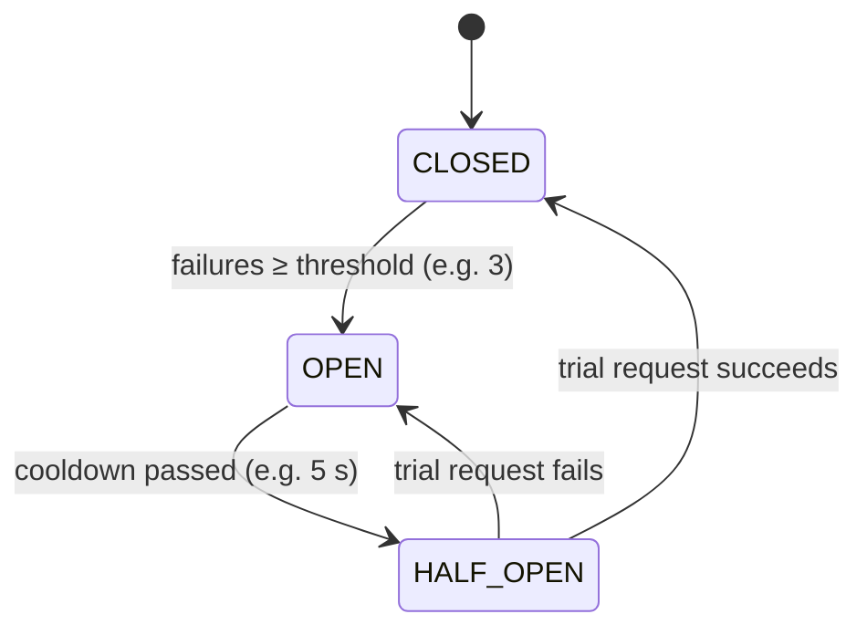

# 13 · Circuit Breaker

> **Interview question:** "The payment service is down and every call to it hangs for 3 seconds. Soon your checkout service runs out of threads and goes down too. How do you stop one failure from taking everything down?"

---

## 🧠 The one-line answer

A **circuit breaker** watches calls to another service. After repeated failures it **"trips" and fails fast** instead of waiting on a dead service. After a cooldown it lets **one test request** through to check whether the service has recovered.

---

## 🏠 Real-life analogy

The **MCB (fuse switch)** in your home's electrical board.

- Normal: current flows. **Closed.**
- Short circuit: the MCB **trips** and cuts the power, so the fault doesn't burn down the whole house. **Open.**
- Later you flip it back on **once** to test. Works? Normal again. Trips again? Still broken. **Half-open.**

Software circuit breakers are named after exactly this.

---

## ⚙️ How it works (step by step)

### Step 1: The problem is cascading failure
```
user → checkout → payment (DEAD, each call hangs 3 s)
```
- Every checkout request waits 3 s for a timeout.
- Threads and connections pile up waiting.
- Checkout runs out of resources, so **checkout dies too**.
- Meanwhile retries **hammer** the payment service while it's trying to recover. 💥

### Step 2: Three states

| State | What happens |
|---|---|
| 🟢 **CLOSED** | Normal. Requests pass through. Count failures. |
| 🔴 **OPEN** | Too many failures. **Reject immediately** (fail fast) for a cooldown period. |
| 🟡 **HALF-OPEN** | Cooldown over. Let **one trial request** through. Success → CLOSED. Fail → OPEN again. |



### Step 3: Fail fast, with a fallback
When the circuit is OPEN, don't just show an error. Give a **fallback**:
- "Payments are slow right now. Try again in a minute" (instantly, no 3 s spinner)
- Offer **Cash on Delivery**
- Show **cached** data (e.g. last known recommendations)
- Queue the action and do it later

### Step 4: Pick the numbers
- **Failure threshold:** e.g. 3 failures in a row, or 50% errors over the last 20 calls
- **Timeout per call:** keep it short (≈1–3 s). A long timeout makes everything worse.
- **Cooldown:** e.g. 5–30 s before the half-open trial

---

## 📐 The numbers

From the demo: payment service **down for the first 10 s**, a user taps "Pay" **every second**, and each dead call hangs **3 s**:

| | Users' total waiting | Calls hitting the dead service |
|---|---|---|
| Without breaker | **30.2 s** | 14 |
| With breaker (3 fails → open 5 s) | **9.2 s** | **7** |

Timeline with the breaker:
```
t=0–2s   3 timeouts         → trips to OPEN
t=3–9s   fail fast, 0 ms    → users told instantly, service left alone to recover
t=10s    HALF-OPEN trial ✅ → back to CLOSED, payments work
```

---

## 🏭 In production

**Node.js (opossum)**
```js
const CircuitBreaker = require('opossum');
const breaker = new CircuitBreaker(callPayment, {
  timeout: 3000,                // call fails if slower than 3 s
  errorThresholdPercentage: 50, // trip when 50% of calls fail
  resetTimeout: 5000,           // try again (half-open) after 5 s
});
breaker.fallback(() => ({ status: 'try_later' }));
await breaker.fire(order);
```

**Java (Resilience4j)**
```java
@CircuitBreaker(name = "payment", fallbackMethod = "payLater")
public Receipt pay(Order o) { return paymentClient.pay(o); }
```

**Service mesh (no code changes):** Istio / Envoy *outlier detection* ejects failing hosts automatically.

---

## ⚖️ Trade-offs

| 👍 Pros | 👎 Cons |
|---|---|
| One failing service doesn't take everything down | Some requests are rejected even after the service is back (until the trial) |
| Users get an instant answer instead of a long spinner | Thresholds need tuning: too sensitive means false trips |
| Gives the failing service room to recover | State is per-instance. 10 servers each learn on their own |
| Clear signal for alerts ("circuit open!") | Fallbacks must be designed per feature |

**Pairs well with:** timeouts, retries with **exponential backoff** (but only through the breaker), **bulkheads** (separate thread pools per dependency), and idempotency (Day 11) so retries are safe.

---

## 🌍 Where it's used in the real world

- **Netflix**: made it popular with **Hystrix**. If recommendations fail, show a generic row instead of an error page.
- **E-commerce checkout**: payment gateway down, so offer another gateway or COD.
- **Microservices everywhere** via Resilience4j, Polly (.NET), opossum (Node)
- **Service meshes** (Istio, Linkerd) and API gateways

---

## 🎯 Interview one-liner

> "Wrap calls to the payment service in a circuit breaker with short timeouts. After about 3 failures it opens and fails fast for a cooldown, say 5 s, returning a fallback like 'try later' or COD instead of making users wait 3 s each and exhausting our threads. After the cooldown it goes half-open and lets one trial request through: success closes it, failure opens it again. This stops one dead service from cascading into ours and gives it room to recover."

---

## 🧪 Try it yourself

```bash
node code/circuit-breaker.js
```
[`code/circuit-breaker.js`](../code/circuit-breaker.js) simulates a 10 s payment outage with and without a breaker.
