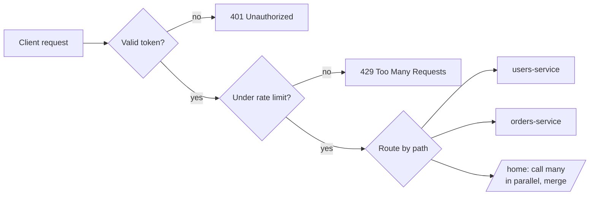

# 14 · API Gateway

> **Interview question:** "You split your app into 20 microservices. Should the mobile app call all 20 directly? Where do auth, rate limiting and logging go?"

---

## 🧠 The one-line answer

An **API gateway** is the **single front door** for all clients. It **routes** each request to the right service and handles shared jobs like **auth, rate limiting, logging and response aggregation** in one place.

---

## 🏨 Real-life analogy

A **hotel reception desk**.

- Guests don't walk into the kitchen, laundry or housekeeping themselves. They go to **reception**.
- Reception **checks your room key** (auth), **sends your request** to the right department (routing), and won't let one guest order 100 things a minute (rate limit).
- Ask "what's on today?" and reception **collects** info from spa, restaurant and events and gives you **one answer** (aggregation).

---

## ⚙️ How it works (step by step)

### Step 1: The problem without a gateway
```
mobile app ──► users-service    (needs auth logic)
           ──► orders-service   (needs auth logic again)
           ──► offers-service   (…and again)
           ──► 17 more…
```
- The app must know **20 addresses**.
- **Every** service re-implements auth, rate limits and logging.
- The home screen needs **3 calls over a slow mobile network**.
- Rename or split a service and **every app version breaks**.

### Step 2: Put a gateway in front
```
                         ┌──► users-service
mobile / web ──► GATEWAY ┼──► orders-service
  (one URL)              └──► offers-service
```

### Step 3: What the gateway does

| Job | Example |
|---|---|
| **Routing** | `/users/*` → users-service, `/orders/*` → orders-service |
| **Authentication** | Verify the JWT once, pass the user id to services |
| **Rate limiting** | 100 req/min per user (Day 07) |
| **Aggregation** | `/home` → calls users + orders + offers **in parallel**, returns one JSON |
| **Protocol translation** | Public REST/JSON outside, gRPC between services inside |
| **Cross-cutting** | Logging, metrics, CORS, SSL termination, caching, request IDs |
| **Resilience** | Timeouts, retries, circuit breakers (Day 13) |



### Step 4: Backend for Frontend (BFF)
Mobile wants small payloads and web wants rich ones. Many companies run **one gateway per client type**: a mobile BFF and a web BFF.

### Step 5: Don't make it a bottleneck
- Run **multiple gateway instances** behind a load balancer (Day 06).
- Keep it **thin**: routing and cross-cutting concerns only. **No business logic.**

---

## 📐 The numbers

From the demo: a home screen needs **user + orders + offers**, mobile round trip ≈ 150 ms, inside the data center ≈ 10 ms:

| Approach | Time |
|---|---|
| App calls 3 services one by one | 3 × 150 = **450 ms** |
| App calls gateway `/home` once (gateway fans out in parallel) | 150 + 10 = **160 ms** ✅ ~2.8× faster |

Gateway checks from the demo: no token → **401**, unknown path → **404**, over the limit → **429**, all before any service is touched.

---

## 🏭 In production

| Tool | Notes |
|---|---|
| **AWS API Gateway** | Managed, plus Lambda integration |
| **Kong** | Open source, built on Nginx, many plugins |
| **Nginx / Envoy** | DIY routing and rate limits |
| **Spring Cloud Gateway** | Java / Spring ecosystem |
| **Apigee, Azure APIM** | Enterprise API management |

**Nginx as a minimal gateway**
```nginx
location /users/  { proxy_pass http://users-service:3001; }
location /orders/ { proxy_pass http://orders-service:3002; }
location /offers/ { proxy_pass http://offers-service:3003; }
```

**Kong rate limit plugin**
```bash
curl -X POST http://kong:8001/services/orders/plugins \
  --data name=rate-limiting --data config.minute=100
```

---

## ⚖️ Trade-offs

| 👍 Pros | 👎 Cons |
|---|---|
| One URL for clients, internals can change freely | **Single point of failure** if not replicated |
| Auth, rate limits and logs written once | One extra network hop (~a few ms) |
| Aggregation cuts mobile round trips | Can become a "god service" if business logic creeps in |
| Internal services not exposed to the internet | Every new route needs a gateway change and deploy |

---

## 🌍 Where it's used in the real world

- **Netflix** (Zuul): one entry for hundreds of services
- **Swiggy / Zomato** apps: home screen aggregated from many services
- **Public APIs** (Razorpay, Stripe): auth, rate limits and versioning at the edge
- **Kubernetes**: Ingress controllers act as the cluster's gateway

---

## 🎯 Interview one-liner

> "Clients shouldn't talk to 20 services directly. I'd put an API gateway in front as the single entry point. It routes by path, verifies the JWT once, applies rate limits, and aggregates calls like the home screen in parallel, so the phone makes one 160 ms call instead of three sequential 150 ms ones. I'd keep it thin with no business logic, run several instances behind a load balancer, and consider separate BFFs for mobile and web."

---

## 🧪 Try it yourself

```bash
node code/api-gateway.js
```
[`code/api-gateway.js`](../code/api-gateway.js) shows routing, auth, rate limits and the aggregated `/home` call.
