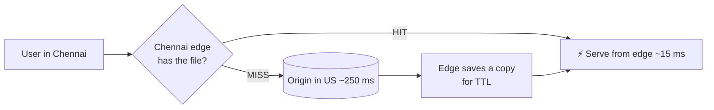

# 15 · CDN (Content Delivery Network)

> **Interview question:** "Your servers are in the US. Users in India say product images load slowly. How do you fix it without moving your servers?"

---

## 🧠 The one-line answer

A **CDN** is a network of **edge servers** spread around the world that **cache copies** of your content close to users, so most requests never travel to your far-away **origin** server.

---

## 🏪 Real-life analogy

**Amul's main dairy** is in Anand, Gujarat.

- Without a CDN: every family in Chennai orders milk **directly from Anand**. Slow, and the dairy is overwhelmed.
- With a CDN: there's a **local milk booth** in every city. The booth gets stock from Anand **once**, then serves the whole neighbourhood in minutes.
- When the booth runs out or stock expires (**TTL**), it restocks from the dairy.

The dairy is your origin. The booths are CDN edge servers.

---

## ⚙️ How it works (step by step)

### Step 1: Distance is the problem
Data travels through fibre at a fraction of the speed of light, so **distance = delay**:
```
Chennai ↔ US origin   ≈ 250 ms round trip
Chennai ↔ Chennai edge ≈ 15 ms
```
A page with 50 images and scripts pays that delay **again and again**.

### Step 2: Users are routed to the nearest edge
Your domain (`cdn.myshop.com`) points to the CDN. Through **DNS / anycast**, each user automatically connects to the **closest edge**: Mumbai users to Mumbai, Delhi users to Delhi.

### Step 3: Cache hit or miss at the edge
```
1st user in Chennai:  edge has nothing → MISS → fetch from origin → cache it → serve
2nd…10,000th user:    edge has it      → HIT  → serve in ~15 ms ✅
```



### Step 4: Control freshness with TTL and versioning
Your origin tells the CDN how long to keep things:
```http
Cache-Control: public, max-age=31536000, immutable    # 1 year for hashed files
Cache-Control: public, max-age=60                     # 1 minute for a price list
```
**Best practice:** put a hash in the file name (`app.3f9a2c.js`). A new version means a new name, so no stale caches.
Need to remove something now? **Purge / invalidate** it on the CDN.

### Step 5: What goes on a CDN?
- ✅ **Static:** images, videos, CSS, JS, fonts, downloads
- ✅ **Video streaming** chunks (HLS / DASH)
- ⚠️ **Dynamic API responses:** only with care (short TTL, no user-specific data)
- ❌ **Personal data** like "my orders" or "my cart": never cache publicly

---

## 📐 The numbers

From the demo: **10,000** requests for one image from **5 Indian cities**, origin in the US:

| | Avg load time | Requests reaching origin |
|---|---|---|
| Without CDN | **250 ms** | **10,000** |
| With CDN | **15.1 ms** | **5** (one miss per city) |

**Cache hit ratio 99.95%**, origin load cut by **99.95%**. The origin can be a much smaller server, and bandwidth bills drop too.

---

## 🏭 In production

| CDN | Notes |
|---|---|
| **Cloudflare** | Free tier, huge edge network, also DDoS protection |
| **AWS CloudFront** | Pairs with S3 as the origin |
| **Akamai** | Oldest and largest, big media and banking clients |
| **Fastly** | Instant purges, programmable edge |
| **Vercel / Netlify** | Built-in CDN for frontend apps |

**Serve static files with long caching (Express)**
```js
app.use('/static', express.static('public', { maxAge: '365d', immutable: true }));
```

**Purge a file on CloudFront**
```bash
aws cloudfront create-invalidation --distribution-id E123ABC --paths "/images/banner.jpg"
```

---

## ⚖️ Trade-offs

| 👍 Pros | 👎 Cons |
|---|---|
| Much faster for far-away users | **Stale content** until TTL expires or you purge |
| Origin handles a tiny fraction of traffic | Cost per GB served (usually cheaper than origin bandwidth) |
| Absorbs traffic spikes and DDoS attacks | Debugging is harder ("which edge served this?") |
| Lower bandwidth costs at the origin | First request in each region is still slow (cold cache) |

---

## 🌍 Where it's used in the real world

- **Netflix**: Open Connect boxes placed inside Indian ISPs (Jio, Airtel), so shows stream from nearby
- **Hotstar / JioCinema**: cricket match streams to crores of viewers through CDNs
- **Flipkart / Amazon**: product images and JS bundles
- **Every modern website**: fonts, scripts, images via Cloudflare / CloudFront

---

## 🎯 Interview one-liner

> "Put static content like images, JS, CSS and video on a CDN. DNS sends each user to the nearest edge, which caches the file after the first miss, so Indian users get ~15 ms instead of ~250 ms from the US origin, and the origin sees only a handful of requests. Control freshness with Cache-Control TTLs and hashed file names, purge when needed, and never cache user-specific responses publicly."

---

## 🧪 Try it yourself

```bash
node code/cdn.js
```
[`code/cdn.js`](../code/cdn.js) compares 10,000 image loads with and without edge caching.
