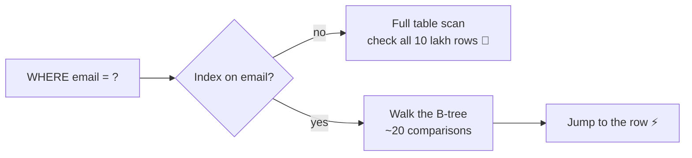

# 16 · Database Indexing

> **Interview question:** "Login is slow. The query is `SELECT * FROM users WHERE email = ?` on a table with 10 lakh rows. How do you speed it up, and why does it work?"

---

## 🧠 The one-line answer

An **index** is a separate, sorted lookup structure (usually a **B-tree**) that lets the database **jump straight to matching rows** instead of scanning the whole table.

---

## 📚 Real-life analogy

A 1,000-page **textbook**.

- **No index:** to find "Photosynthesis", flip through **every page** from page 1. That's a full table scan.
- **With the index at the back:** it's sorted A→Z, so you jump to **P**, find "Photosynthesis → page 412", and open page 412 directly.
- The index costs **extra pages**, and when you add a new chapter, the index **must be updated** too.

---

## ⚙️ How it works (step by step)

### Step 1: Without an index, a full table scan
```sql
SELECT * FROM users WHERE email = 'user999993@gmail.com';
```
The database checks **row 1, row 2, row 3…** until it finds a match. With 10 lakh rows, that's up to **10 lakh checks**, and it gets slower as the table grows.

### Step 2: Create an index
```sql
CREATE INDEX idx_users_email ON users(email);
```
The database builds a **sorted structure** of `email → row location`.

### Step 3: B-tree, the default index
A B-tree is a short, wide, **sorted** tree:
```
                 [ m… ]
              /          \
        [ d… | h… ]     [ r… | v… ]
        /   |    \       /   |   \
     leaves with sorted emails → row pointers
```
- Each step down **cuts the search space** massively.
- 10 lakh rows → about **20 comparisons** with binary search. Real B-trees need only **3–4 disk reads**, because each node holds hundreds of keys.
- Because it's **sorted**, it handles `=`, `<`, `>`, `BETWEEN`, `ORDER BY` and `LIKE 'abc%'`.

### Step 4: Hash index for exact match only
- `email → row` via a hash map: **1 step** for `=`.
- ❌ Useless for ranges (`age BETWEEN 25 AND 30`), because hashing scatters neighbouring values.

### Step 5: Composite indexes follow the left-most prefix rule
```sql
CREATE INDEX idx_city_age ON users(city, age);
```
- ✅ `WHERE city = 'Noida'`
- ✅ `WHERE city = 'Noida' AND age > 25`
- ❌ `WHERE age > 25` alone (like a phone book sorted by surname, then first name: you can't search by first name alone)

### Step 6: Check that the index is actually used
```sql
EXPLAIN ANALYZE SELECT * FROM users WHERE email = 'a@b.com';
-- before:  Seq Scan on users          (scans every row)
-- after:   Index Scan using idx_users_email
```



---

## 📐 The numbers

From the demo: find one email among **10,00,000** rows:

| Method | Rows checked | Time (this run) |
|---|---|---|
| No index (full scan) | **9,99,994** | ~30 ms |
| B-tree index | **18** | ~0.2 ms |
| Hash index | **1** | ~0.03 ms |

**Why ~20:** log₂(10,00,000) ≈ 20. Double the table and it's just **one more step**.

Range query `age BETWEEN 25 AND 30`: the B-tree jumps to the first 25 in ~20 steps, then reads the **1,20,000** matching rows in order. A hash index can't help here.

On a real disk the gap is far bigger: a full scan reads **gigabytes**, while an index lookup reads a few **8 KB pages**.

---

## 🏭 In production

```sql
-- the basics
CREATE INDEX idx_orders_user ON orders(user_id);
CREATE UNIQUE INDEX idx_users_email ON users(email);    -- also enforces uniqueness

-- composite: matches WHERE user_id = ? ORDER BY created_at DESC
CREATE INDEX idx_orders_user_time ON orders(user_id, created_at DESC);

-- Postgres: build without locking writes on a live table
CREATE INDEX CONCURRENTLY idx_orders_status ON orders(status);

-- find slow queries to index (Postgres, needs pg_stat_statements)
SELECT query, mean_exec_time FROM pg_stat_statements ORDER BY mean_exec_time DESC LIMIT 10;
```

**MongoDB**
```js
db.users.createIndex({ email: 1 }, { unique: true });
```

---

## ⚖️ Trade-offs

| 👍 Pros | 👎 Cons |
|---|---|
| Lookups go from O(n) to O(log n) | **Slower writes**: every INSERT/UPDATE also updates each index |
| Fast sorting, ranges, joins | **Extra storage** (indexes can be as big as the table) |
| Unique indexes enforce data rules | Too many indexes confuse the planner and waste RAM |
| Covering indexes can answer queries without touching the table | Low-selectivity columns (e.g. `gender`) barely help |

**Rule of thumb:** index columns you **filter, join or sort on** often, and check with `EXPLAIN`. Don't index everything.

---

## 🌍 Where it's used in the real world

- **Login**: unique index on `email` / `phone`
- **"My orders" page**: index on `(user_id, created_at)`
- **Search by PNR / order id**: primary-key index
- **Leaderboards**: index on `score DESC`
- **Every database**: Postgres, MySQL (InnoDB stores the table itself as a B-tree on the primary key), MongoDB, SQLite

---

## 🎯 Interview one-liner

> "The query does a full table scan over 10 lakh rows. Add a unique B-tree index on `email`: it's sorted, so the database finds the row in about log₂(n) ≈ 20 comparisons, really 3–4 page reads, instead of scanning everything, and it also supports ranges and ORDER BY, which hash indexes can't. Confirm with EXPLAIN ANALYZE. The cost is slower writes and extra storage, so I'd index only columns used in WHERE, JOIN and ORDER BY, respecting the left-most prefix rule for composite indexes."

---

## 🧪 Try it yourself

```bash
node code/indexing.js
```
[`code/indexing.js`](../code/indexing.js) compares a full scan, a B-tree-style lookup and a hash lookup on 10 lakh rows.
